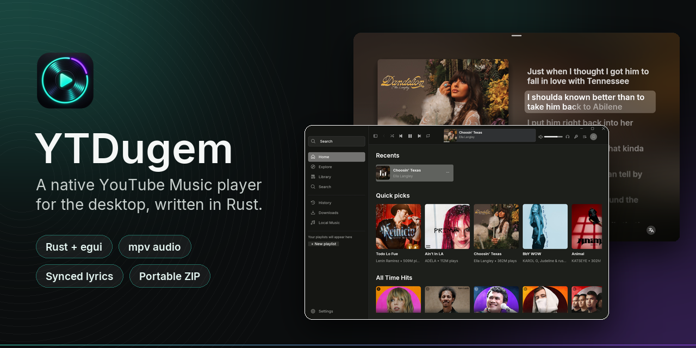
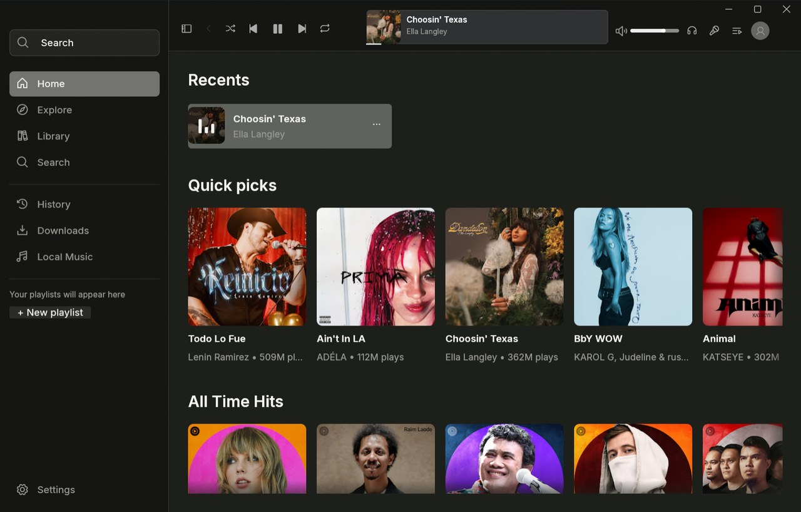
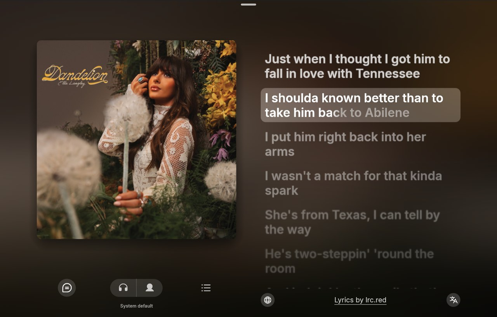
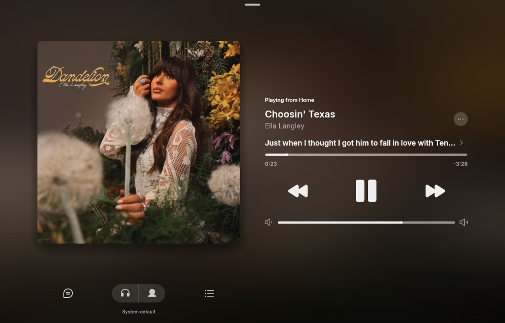
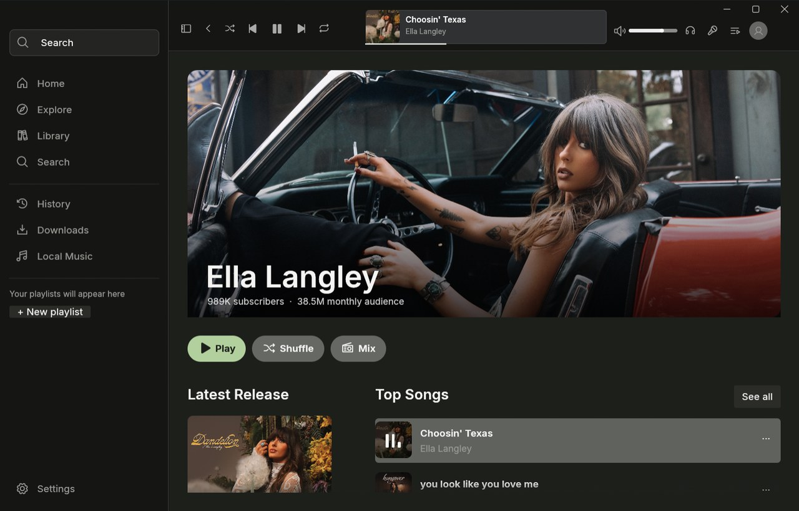
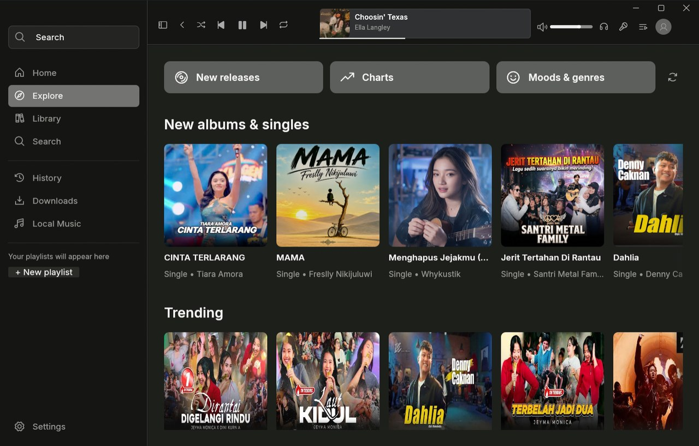
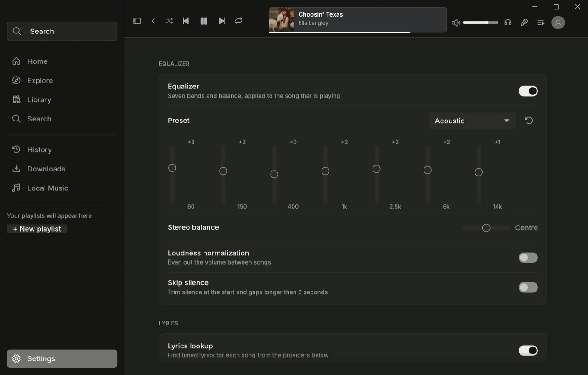
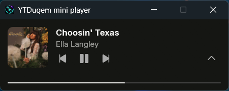

<div align="center">



<br />

[](https://github.com/TazakiN/YTDugem/releases/latest)
[](https://github.com/TazakiN/YTDugem/actions/workflows/check.yml)
[](https://github.com/TazakiN/YTDugem/releases)
[](LICENSE)
[](#download)
[](https://www.rust-lang.org)

**A native YouTube Music player for the desktop.**<br />
A Rust rewrite of [BitChord](https://github.com/kushagrasinghx/BitChord): drawn with egui, played through mpv.<br />
No JVM, no embedded browser, no web frontend.

[**Download**](#download) · [Features](#features) · [Screenshots](#screenshots) · [Build from source](#build-from-source) · [User guide](docs/USAGE.md) · [Contributing](#contributing)

</div>

<br />

<p align="center">
  
</p>

> [!NOTE]
> YTDugem is a working rewrite, **not yet at feature parity** with upstream BitChord. Windows comes first, and Linux is kept working where practical. See [what has not been ported](#not-yet-ported).

## Features

<table>
<tr>
<td width="50%" valign="top">

🏠 **Home, Explore and search**<br />
Real YouTube Music shelves, new releases, charts, moods & genres, and live search. Public browsing needs no account.

🎤 **Synced lyrics**<br />
Line- and word-timed lyrics from fifteen providers, each one reorderable or switchable off. The panel shows which source answered.

👤 **Artist pages**<br />
Banner, top songs, albums, singles, related artists and the biography. Click any artist name to open one.

🎚️ **Sound you control**<br />
Seven-band equalizer with presets, stereo balance, loudness normalization, skip silence, crossfade and 0.5–2× speed.

</td>
<td width="50%" valign="top">

📚 **Your library, your way**<br />
Liked songs, history, local playlists, a local-files library with drag-and-drop import, and M3U8/CSV export.

🔐 **Optional Google sign-in**<br />
Personalized Home, account playlists, likes and ratings. Sessions are encrypted with Windows DPAPI.

🪟 **Desktop native**<br />
Mini player (<kbd>Ctrl</kbd>+<kbd>M</kbd>), Windows media controls, tray playback, keyboard shortcuts and in-place updates.

⬇️ **Downloads and SponsorBlock**<br />
Save audio with embedded metadata. Optionally skip the talking parts of music videos (off by default).

</td>
</tr>
</table>

The [user guide](docs/USAGE.md#features) describes each feature in detail, including its limits.

## Screenshots

<table>
  <tr>
    <td width="50%"></td>
    <td width="50%"></td>
  </tr>
  <tr>
    <td align="center"><sub><b>Word-synced lyrics</b></sub></td>
    <td align="center"><sub><b>Full-screen player</b></sub></td>
  </tr>
  <tr>
    <td></td>
    <td></td>
  </tr>
  <tr>
    <td align="center"><sub><b>Artist pages</b></sub></td>
    <td align="center"><sub><b>Explore</b></sub></td>
  </tr>
  <tr>
    <td></td>
    <td align="center"></td>
  </tr>
  <tr>
    <td align="center"><sub><b>Equalizer and audio settings</b></sub></td>
    <td align="center"><sub><b>Mini player</b></sub></td>
  </tr>
</table>

## Download

| Package | Best for |
|---|---|
| [**`YTDugem-windows-x86_64-setup.exe`**](https://github.com/TazakiN/YTDugem/releases/latest) | Most people. Installs for your user without admin rights and adds a Start menu entry. |
| [`YTDugem-windows-x86_64.zip`](https://github.com/TazakiN/YTDugem/releases/latest) | Portable use. Extract the **whole** archive and run `YTDugem/YTDugem.exe`. |

Both packages bundle everything YTDugem needs: **mpv, yt-dlp, FFmpeg/ffprobe and Deno** live in the `tools` folder beside the executable. You don't have to install anything or change `PATH`. Each release also has a `.sha256` file for checking the download.

> [!IMPORTANT]
> The `.exe` on its own is not a portable app. Keep the `tools` folder beside `YTDugem.exe`.

Untested builds of every `main` commit are attached to the [CI runs](https://github.com/TazakiN/YTDugem/actions). For Linux and WSL, see the [user guide](docs/USAGE.md#linux).

## Keyboard shortcuts

| Keys | Action | Keys | Action |
|---|---|---|---|
| <kbd>Space</kbd> | Play / pause | <kbd>Ctrl</kbd>+<kbd>F</kbd> | Search |
| <kbd>Alt</kbd>+<kbd>←</kbd> / <kbd>→</kbd> | Previous / next | <kbd>Ctrl</kbd>+<kbd>L</kbd> | Import local files |
| <kbd>F11</kbd> | Full-screen player | <kbd>Ctrl</kbd>+<kbd>M</kbd> | Mini player |
| <kbd>L</kbd> / <kbd>Q</kbd> | Lyrics / queue (full-screen player) | <kbd>Ctrl</kbd>+<kbd>Q</kbd> | Quit |

[All shortcuts](docs/USAGE.md#keyboard-shortcuts)

## Build from source

You need [Rust](https://rustup.rs) 1.95 or newer (MSVC toolchain on Windows), plus **mpv**, **yt-dlp** and **FFmpeg** on `PATH`.

```sh
git clone https://github.com/TazakiN/YTDugem.git
cd YTDugem
cargo run --release --locked
```

To build the same portable ZIP that releases ship (version-pinned, SHA-256-checked runtime downloads), run:

```sh
cargo xtask package   # build and package dist/YTDugem-windows-x86_64.zip
cargo xtask smoke     # test the extracted ZIP in a clean folder
```

<details>
<summary><b>Project layout</b></summary>

| Path | Contents |
|---|---|
| `src/ui.rs`, `src/ui/` | egui interface: pages, full-screen player, mini player, updater |
| `src/player.rs` | mpv process, IPC and playback controls |
| `src/services.rs` | YouTube Music search and browse, lyrics, downloads, local import |
| `src/auth.rs` | Browser sign-in and encrypted session storage |
| `src/store.rs` | Library persistence, backups and locking |
| `src/runtime.rs` | Finding the bundled `tools` folder |
| `xtask/` | `cargo xtask ci`, `package` and `smoke` |
| `scripts/` | Packaging, installer and Windows smoke tests |

</details>

## Not yet ported

YTDugem does not have these upstream BitChord features yet: syncing local playlists to your account, brand-channel discovery, Spotify and other source modules, Last.fm and ListenBrainz, listen-together, canvas video, Automix, and the dynamic equalizer. Discord Rich Presence is shown as "coming soon". Android, TV, Wear OS and web targets are out of scope.

Account playlist editing and ratings are unit tested against made-up fixtures but **still need verification with a real Google account**. The [user guide](docs/USAGE.md) tracks every gap.

## Contributing

Bug reports and pull requests are welcome. Before you open a pull request, run the same checks as CI:

```sh
cargo ci   # fmt, clippy -D warnings, tests and a release build
```

See [CONTRIBUTING.md](CONTRIBUTING.md) for tests that need network access or audio, and [SECURITY.md](SECURITY.md) for reporting vulnerabilities. Everyone taking part follows the [Code of Conduct](CODE_OF_CONDUCT.md).

## Acknowledgements

- [**BitChord**](https://github.com/kushagrasinghx/BitChord) by kushagrasinghx and contributors: the original app whose design and behavior YTDugem follows.
- [egui](https://github.com/emilk/egui), [mpv](https://mpv.io), [yt-dlp](https://github.com/yt-dlp/yt-dlp), [FFmpeg](https://ffmpeg.org) and [Deno](https://deno.com), which do most of the heavy lifting.
- The lyrics providers, [SponsorBlock](https://sponsor.ajay.app) and the [Inter](https://rsms.me/inter/) typeface.

## License

YTDugem is free software under the [GNU General Public License v3.0 only](LICENSE). It is based on BitChord; see [NOTICE](NOTICE) for attribution and bundled third-party software.

<sub>YTDugem is an independent client. It is not affiliated with, endorsed by, or sponsored by YouTube or Google. Artwork in the screenshots belongs to its respective owners. Only download media you are authorized to save.</sub>
